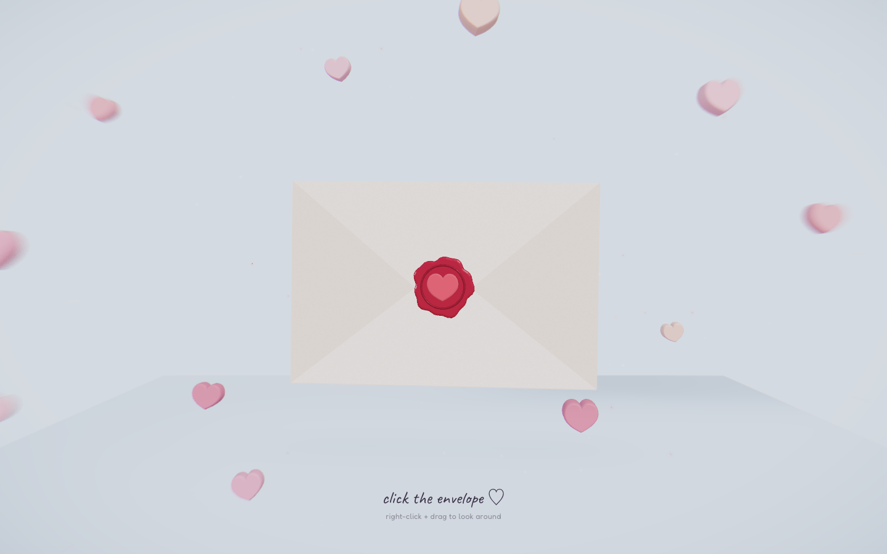
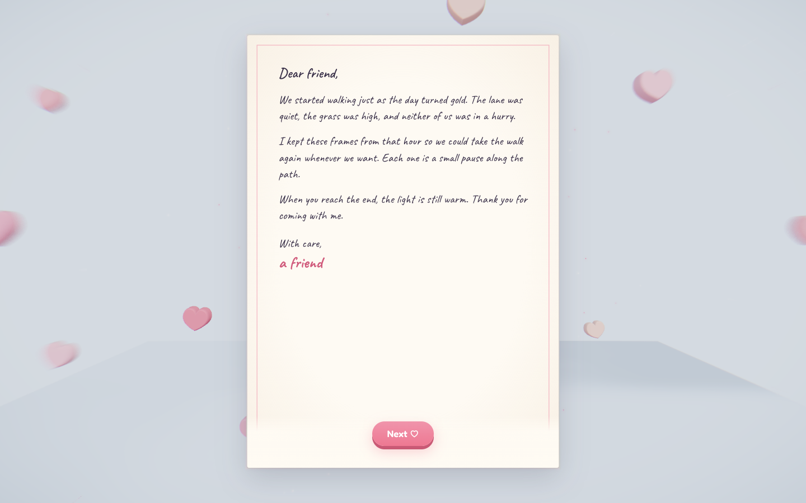
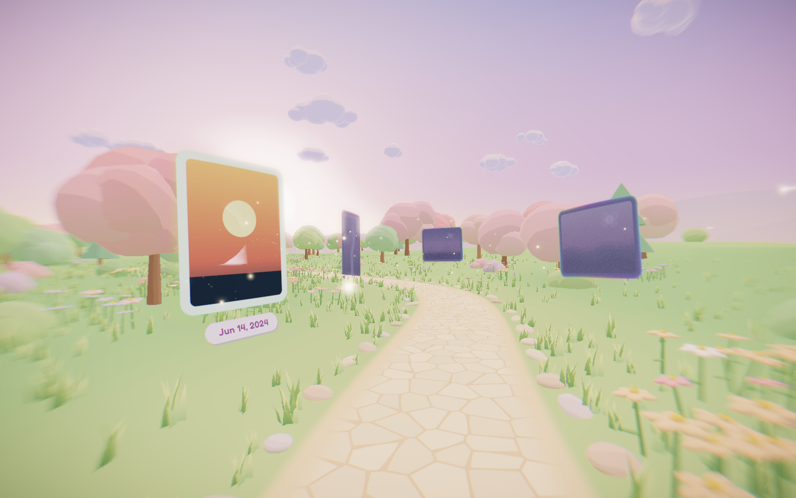

# Walk Letter

A small site for a photo walk and a letter. You open a sealed envelope, read the note, and walk a meadow path where each photo appears as a sticker with its date.

The sample is a fictional golden-hour walk. Make your own in the browser at `/customize`, or replace the photos, the dates, and the letter in the repository. The envelope opens immediately. There is no password.

## Quick start

```bash
npm install
npm run dev
```

Open the local URL that Next.js prints. `npm run dev` prepares the sample photos, then starts the app.

## Make one in the browser

Open `/customize`.

1. Drop in as many photos as you like (up to 300). They are resized in the browser, and dates come from each photo's EXIF data when it has them. Drag to reorder, or sort by date.
2. Write the letter.
3. Click **Create my link** and copy the link. Whoever opens `/<id>` gets the envelope, your letter, and the walk with your photos.

The draft is saved in your browser (localStorage for the letter, IndexedDB for the photos), so a reload keeps your work. Photos and the letter are only uploaded when you create the link. A link never changes after it is made. See [Customize and share](docs/04-customize-and-share.md).

## Make it yours in the repository

1. Drop photos into [`drop/`](drop/). See [Add your photos](docs/01-add-your-photos.md).
2. Edit the dates in [`src/data/photos.json`](src/data/photos.json). See [Edit the dates](docs/02-edit-the-dates.md).
3. Edit the paragraphs in [`src/data/letter.json`](src/data/letter.json). See [Edit the letter](docs/03-edit-the-letter.md).

## Screenshots

The sealed envelope. Click or tap it to open the letter.



The sample letter.



One photo on the meadow path, with its date.



## Project structure

| Path | Purpose |
| --- | --- |
| `drop/` | Photos you add. The script does not change these files. |
| `public/photos/` | Generated JPGs the walk displays. |
| `src/data/photos.json` | `filename`, `date`, `width`, and `height` for each photo. |
| `src/data/letter.json` | Greeting, paragraphs, sign-off, and an optional ending URL. |
| `public/fonts/fredoka-600.woff` | Fredoka file used by the 3D date labels. |
| `app/customize/` | The browser editor. |
| `app/[id]/` | Plays a shared letter. |
| `app/api/` | Upload, publish, and photo routes for shared letters. |
| `.data/` | Shared letters when no Blob store is connected (local only). Do not commit this folder. |

## Fonts

The interface uses [Caveat](https://fonts.google.com/specimen/Caveat) and [Fredoka](https://fonts.google.com/specimen/Fredoka). Both are licensed under the [SIL Open Font License 1.1](https://openfontlicense.org/open-font-license-official-text/).

The 3D date labels load `public/fonts/fredoka-600.woff`. That file is Fredoka and stays under the same SIL Open Font License 1.1. A short notice sits beside it in [`public/fonts/OFL.txt`](public/fonts/OFL.txt).

## Deploy it yourself

The sample at `/` needs no setup. Shared letters need somewhere to keep the uploaded photos, so `/customize` stores them in one of two places:

- **Vercel Blob.** On Vercel, open the project's Storage tab, create a Blob store, and connect it. Vercel adds `BLOB_READ_WRITE_TOKEN` for you. If the store is private, also set `BLOB_ACCESS=private`.
- **Local disk.** Without that token, files go to `.data/` in the project folder. This works for `npm run dev` and for `npm run build && npm start` on a server with a persistent disk.

On Vercel without a Blob store, creating a link returns an error that says to connect one.

```bash
npm install
npm run build
npm start
```

This repository does not deploy for you.

## Contributing

See [CONTRIBUTING.md](CONTRIBUTING.md).

## License

[MIT](LICENSE).
